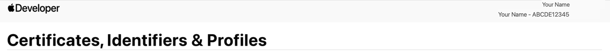
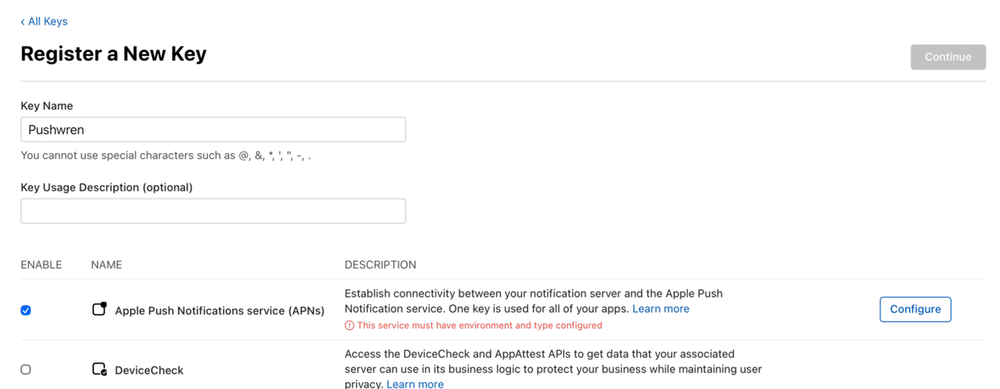
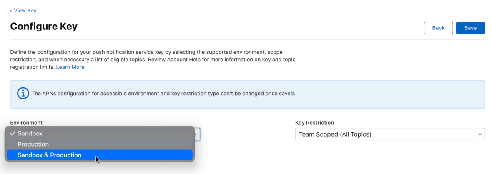
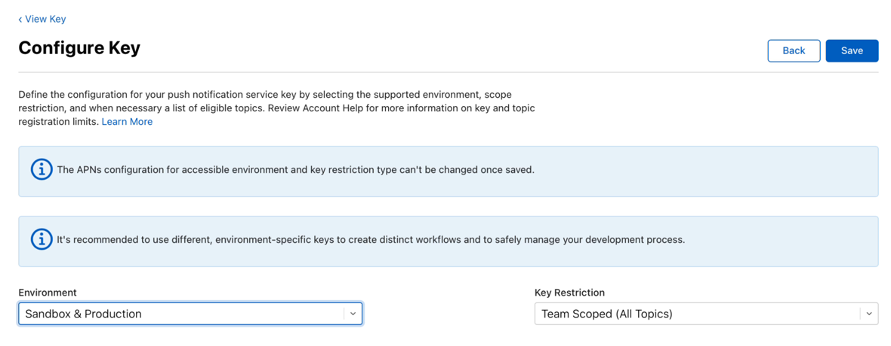
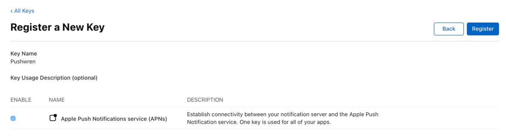
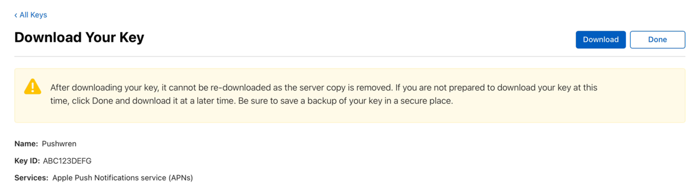

# Making an APNs key

Pushwren sends your notifications through Apple Push Notification service (APNs), and Apple only
accepts them when they're signed with a key from your Apple Developer account. This guide takes you
from no key to a key uploaded to Pushwren. It takes about five minutes, and you do it once: one key
can cover every app on your team.

You'll come away with three things: a `.p8` file, its **Key ID**, and your **Team ID**.

## Before you start

- A Pushwren account, with your app created in the portal.
- A paid Apple Developer Program membership.
- The **Account Holder** or **Admin** role on that team. Other roles can't create keys.

Everything on Apple's side happens at
[developer.apple.com/account](https://developer.apple.com/account), under **Certificates,
Identifiers & Profiles**.

## 1. Find your Team ID

Open **Certificates, Identifiers & Profiles**. Your **Team ID** is at the top right of every page,
after your name: a 10-character code such as `ABCDE12345`. (It's also under **Membership details**
on your account page.) Keep it handy; Pushwren asks for it with the key.

## 2. Turn on Push Notifications for your app

Your app's App ID has to allow push.

**The easy way, in Xcode:** open your target, go to **Signing & Capabilities**, click
**+ Capability** and add **Push Notifications**. With **Automatically manage signing** on, Xcode
turns push on for the App ID for you. You need this capability in the app anyway, so do it now.

**Or on the website:** in Certificates, Identifiers & Profiles, click **Identifiers**, select your
app's App ID, click **Edit**, tick **Push Notifications**, and click **Save** (and **Confirm** if
Apple warns about changing it).

You don't need a push certificate. Keys replace certificates, and Pushwren uses keys only.

<!-- verify: automatic signing turns on Push Notifications for the App ID (checked during the TracQR integration) -->

## 3. Create the key

1. In Certificates, Identifiers & Profiles, click **Keys** in the sidebar, then the blue **+** next
   to the Keys heading.
2. Under **Key Name**, enter a name you'll recognize later, such as `Pushwren`. The description is
   optional.
3. Tick **Apple Push Notifications service (APNs)**. Apple shows "This service must have
   environment and type configured" until you do the next step. Click **Configure**.

   

4. On **Configure Key**, set the two menus. **These can't be changed once saved**, so check them
   before you click Save:
   - **Environment: Sandbox & Production.** Apple selects **Sandbox** by default, so change it.
     Builds you run from Xcode use the sandbox; TestFlight and App Store builds use production. A
     key for both works for every build, while a Sandbox key fails for TestFlight and App Store
     builds and a Production key fails for Xcode builds.
   - **Key Restriction: Team Scoped (All Topics).** It covers every app on your team, now and later.
     With Sandbox & Production it's the only choice.

   

   After you choose Sandbox & Production, Apple suggests separate keys for each environment.
   Pushwren works either way: one key for both is simplest, and if you'd rather follow Apple's
   suggestion, make a Sandbox key and a Production key and upload both to the same app.

   

5. Click **Save**. Back on Register a New Key, APNs now shows **Edit**. Click **Continue**, check
   the summary, and click **Register**.

   

## 4. Download the key

**Download Your Key** shows the key's name and **Key ID**. Click **Download**: Apple saves a file
named `AuthKey_<KeyID>.p8` to your Downloads folder, and the button changes to **Downloaded**. Then
click **Done**.

**You can download a key only once.** Keep the file somewhere safe, such as your password manager.
Never put it in your app or commit it to a repository: anyone with the file can send notifications as
your apps. If you lose it, revoke the key and make a new one.

The **Key ID** is the 10 characters in the file name (`AuthKey_ABC123DEFG.p8` has the Key ID
`ABC123DEFG`). It's also in the **Key ID** column of the **Keys** list.

## 5. Upload it to Pushwren

In the [Pushwren portal](https://app.pushwren.com), open your app's setup (or **Settings → APNs**
later):

1. Choose the `.p8` file. Pushwren fills in the **Key ID** from its name.
2. Enter your **Team ID** from step 1.
3. Click **Upload key**.

Pushwren checks the key with Apple straight away and shows a result for **Sandbox** and for
**Production**. With a Sandbox & Production key, both say **Valid**.

The check can't see a Topic Specific key's list of apps. If the key doesn't include your app, the
first test push tells you.

<!-- screenshot: the upload form, Team ID covered -->

## When something goes wrong

| Pushwren says | What it means | What to do |
| --- | --- | --- |
| **Not enabled for sandbox** (or production), or **Key not enabled for sandbox** after a send | The key works in the other environment only. | Apple doesn't let you change a key's environment. Make a key for the missing environment (or a new Sandbox & Production key) and upload it too. |
| **Check the Key ID and Team ID** | Apple didn't accept this key with these IDs. | Copy the Key ID from the file name and the Team ID from Membership details, and make sure the `.p8` is the file for that key. |
| **Key not allowed for this app** (after a test push), or **Key doesn't cover this app** | The key is Topic Specific, and your bundle ID isn't one of its apps. | Make a Team Scoped key and upload it. |
| **Not yet verified** | Apple's answer didn't settle it. | Send a test push from the portal to confirm. |
| Every push fails after working before | The key was revoked on developer.apple.com. | Make a new key and upload it in **Settings → APNs**. |
